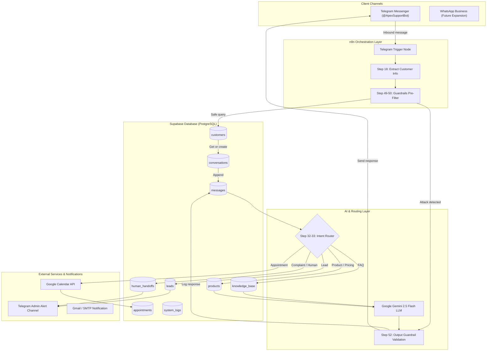

# System Architecture — AI Customer Support Agent

## 1. High-Level Architecture Overview

The **AI Customer Support Agent** is an enterprise-grade multi-channel support automation platform built on top of **n8n**, **Supabase (PostgreSQL)**, **Telegram Bot API**, **Google Gemini AI**, and **Google Workspace (Calendar & Gmail)**.



---

## 2. Component Breakdown

### 2.1 Communication Layer (Telegram)
- **Role**: Primary real-time customer touchpoint.
- **Protocol**: Long-polling in development; secure TLS Webhooks in production.
- **Payload Extraction**: Parses sender `id`, `first_name`, `username`, `chat.id`, message text, and timestamp.

### 2.2 Orchestration Engine (n8n)
- **Role**: Executes the core workflow state machine, routing logic, and integrations.
- **Fault-Tolerance**: Automatically captures any unhandled node exceptions via dedicated `Error Trigger` workflow and dispatches telemetry to `system_logs` and the owner Telegram channel.

### 2.3 Identity & Database Layer (Supabase)
- **Role**: State storage, conversation history, product catalog, knowledge base, and escalation queues.
- **Security**: Row Level Security (RLS) enabled on all 9 tables; accessed securely via `service_role` bearer token from n8n backend.

### 2.4 AI & Reasoning Engine (Google Gemini 2.5 Flash)
- **Role**: Intent analysis, context synthesis, grounded responses, and friendly natural language generation.
- **Grounding Strategy**: Strict Retrieval-Augmented Generation (RAG). Gemini is provided only verified knowledge base content and product records. It is instructed to reject answering questions outside its grounding context.

### 2.5 Guardrail Subsystem
- **Pre-Execution Guard**: Scans incoming text using regex heuristics for prompt injection, jailbreaking, and schema probing.
- **Post-Execution Guard**: Validates LLM outputs to prevent leakage of internal prompt variables, formatting errors, or ungrounded policy hallucination.

---

## 3. Data Processing Lifecycle

```text
1. Customer sends message via Telegram.
2. n8n Telegram Trigger fires.
3. Customer Info Extractor pulls Telegram ID and profile fields.
4. Guardrails Pre-Filter evaluates input for injection/PII attempts.
5. Customer Lookup: Checks Supabase 'customers' table.
   ├─ If exists: Retrieves customer_id.
   └─ If new: Creates record and assigns UUID.
6. Conversation Tracking: Checks for active 'open' conversation.
   ├─ If exists: Uses conversation_id.
   └─ If not: Creates new conversation in 'conversations'.
7. Message Persistence: Saves customer message to 'messages' table.
8. History Retrieval: Fetches last 6 messages for multi-turn context.
9. Intent Routing:
   ├─ Human / Complaint ──► Inserts 'human_handoffs', alerts owner via Telegram.
   ├─ Appointment ────────► Books slot, inserts 'appointments', confirms time.
   ├─ Lead ───────────────► Inserts 'leads', alerts sales team, queries product catalog.
   ├─ Product / Pricing ──► Queries 'products' table for exact prices/features.
   └─ FAQ / General ──────► Queries 'knowledge_base' for grounded company info.
10. Gemini AI Call: Assembles system prompt + verified context + conversation history.
11. Output Validation: Verifies response safety and formatting.
12. Assistant Persistence: Saves assistant reply to 'messages' table.
13. Telegram Response: Dispatches Markdown message to the customer.
```
