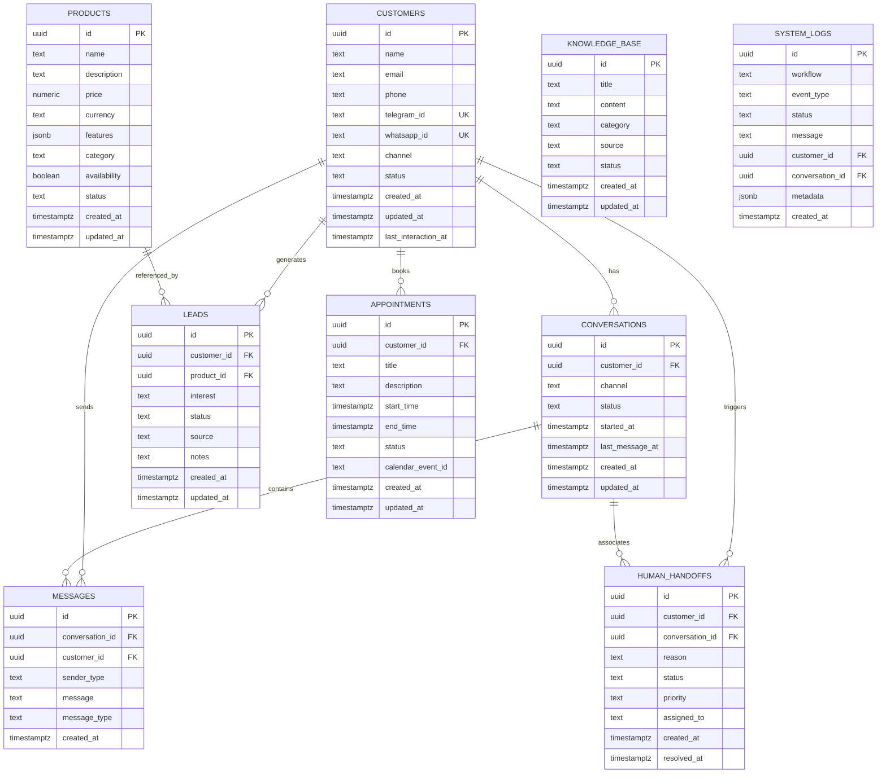

# Database Documentation — Supabase / PostgreSQL

## 1. Entity-Relationship (ER) Model

---

## 2. Table Specifications & Purpose

### 2.1 `customers` (Step 5)
Identifies individual users interacting across Telegram, WhatsApp, or Web.
- `id`: UUID (Primary Key, autogenerated).
- `telegram_id`: Unique identifier from Telegram messaging API. Indexed for sub-millisecond lookup.
- `last_interaction_at`: Automatically updated to track active customer engagement.

### 2.2 `products` (Step 6)
Stores the business catalog of offerings, pricing, and feature breakdowns.
- `price` & `currency`: Authoritative commercial figures. Gemini AI must strictly read from this table.
- `features`: JSON array of key selling points and deliverables.

### 2.3 `conversations` (Step 7)
Maintains session state for ongoing dialogues. A customer can have multiple historical conversations, but only one `status = 'open'` conversation at a given time.

### 2.4 `messages` (Step 8)
Complete, immutable message ledger. Records both `sender_type = 'customer'` and `sender_type = 'assistant'` for complete context recovery and multi-turn dialogue.

### 2.5 `leads` (Step 9)
Tracks prospects showing high purchase intent, target service/product, budget notes, and CRM qualification stages (`new`, `contacted`, `qualified`, `converted`, `closed`).

### 2.6 `appointments` (Step 10)
Stores confirmed meeting consultations synced with Google Calendar, including start/end timestamps and external calendar event IDs.

### 2.7 `knowledge_base` (Step 11)
Grounding repository containing FAQs, operational hours, refund rules, company profile, and contact details. Indexed via Trigram GIN indexes for fast fuzzy retrieval.

### 2.8 `human_handoffs` (Step 12)
Escalation queue when an inquiry requires human intervention due to customer frustration, complex custom scoping, or explicit user demand.

### 2.9 `system_logs` (Step 13)
Centralized logging and audit trail for automated workflows, error tracking, and security monitoring.

---

## 3. Indexing & Optimization Strategy

1. **Unique Indices**:
   - `customers(telegram_id)`
   - `customers(whatsapp_id)`
2. **Foreign Key Indices**:
   - `conversations(customer_id)`
   - `messages(conversation_id, created_at ASC)`
   - `leads(customer_id)`
   - `appointments(customer_id)`
   - `human_handoffs(customer_id)`
3. **Full-Text & Similarity Indices**:
   - `knowledge_base(title gin_trgm_ops)`
   - `knowledge_base(content gin_trgm_ops)`
   - `products(name gin_trgm_ops)`
